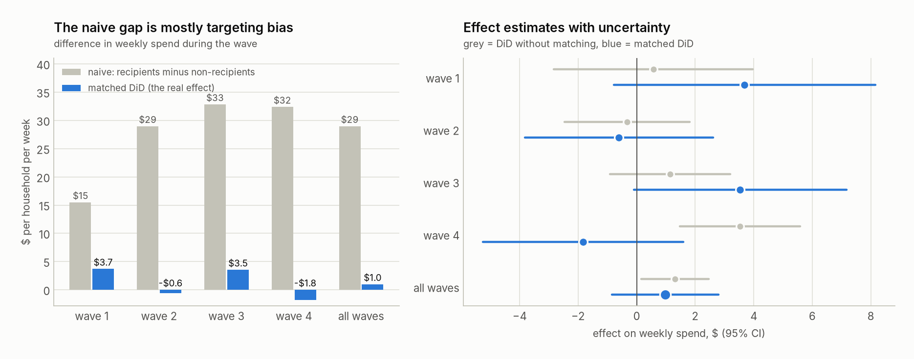
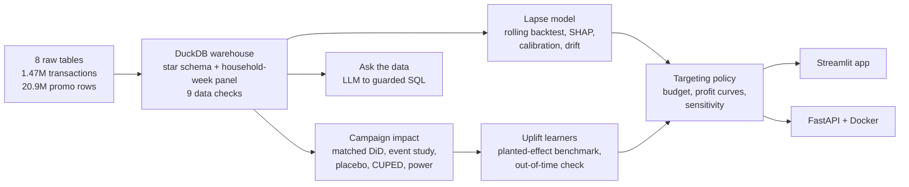
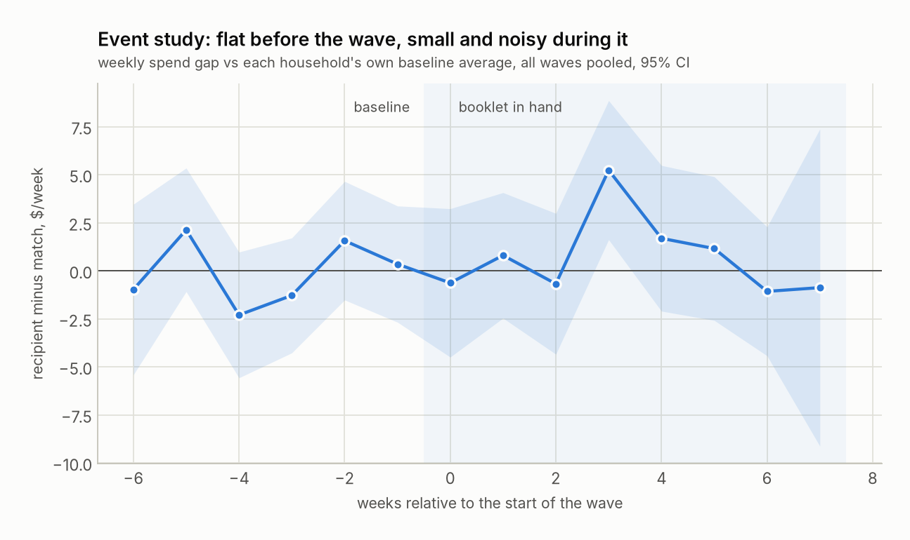
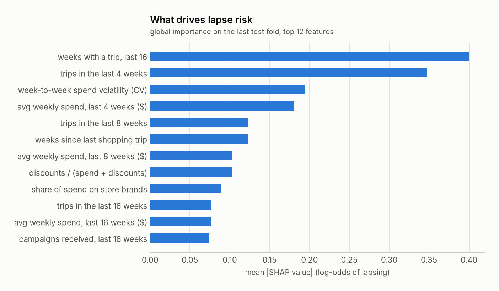
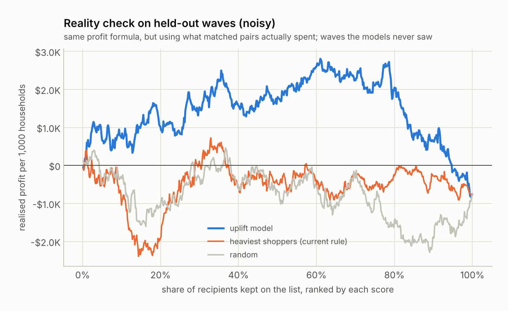

# Coupon ROI & Targeting Engine

**Did a grocery retailer's coupon booklets actually change what people spend, who is about to drift away, and who
should get the next booklet?** Built end to end on a year of real transactions from 2,469 households.

[Live app](https://coupon-roi-targeting-ttxbgtmqvmgmuqn5mb9unq.streamlit.app/) · [Notebooks](notebooks/) · [Write-up](docs/write-up.md) ·
[One-page memo](docs/memo.md) · [Decision log](docs/decisions.md)


## The short version

| Question | Answer |
|---|---|
| **Did the booklets work?** | Recipients spent **$29/week** more than non-recipients, but they already spent 1.4x to 2.6x more *before* any booklet arrived. Against look-alike households, the real effect is **+$0.97/week (+2.4%, 95% CI -2.1% to +7.0%)**. Roughly break-even. |
| **Who is about to go quiet?** | A lapse model for regular shoppers, validated out of time: **ROC-AUC 0.83**. The 10% it flags contain **36%** of the households that go quiet (3.6x random). |
| **Who should get the next booklet?** | An uplift model ranks households by how much a booklet would change their spend. On two waves it never saw, mailing everyone lost **$0.76 per booklet**; its top 30% would have made **$6.61 per booklet** (simulated margins). Promising, not yet significant. |
| **What next?** | Mail by predicted response with a random holdout in every wave. Even with CUPED, an effect this small needs ~8,300 households per arm, so pool holdouts across waves. |



## How it fits together



## 1. Did the booklets work?

The four big booklet waves went to households picked from their purchase history, so a straight comparison of
recipients and non-recipients mostly measures the targeting rule. For each wave I matched every recipient to a
non-recipient who looked the same in the weeks before (spend, trips, trend, store-brand and promo habits, coupon use,
earlier booklets, other campaigns), then compared the **change** in weekly spend (difference-in-differences).

* **Balance:** max standardised difference after matching 0.11 (up to 1.5 before).
* **Pre-trends:** flat for the 6 weeks before each wave (event study below).
* **Placebo:** a fake start date inside the baseline gives +$0.28/week.
* **Robustness:** 7 alternative specifications, including a doubly robust estimator with no matching at all, land
  between +$0.53 and +$1.92/week.
* **Break-even:** $0.74/week at an assumed 28% margin and $1.50 per booklet. Profit per booklet: -$3.22 to +$4.17.
* **Next test:** CUPED cuts variance by 68%, but a $1 effect still needs ~8,300 households per arm.



My first segment analysis "found" that light shoppers respond strongly and heavy shoppers negatively. It was
regression to the mean from cutting segments on the same window used for the baseline. The fix and both versions are
in the [decision log](docs/decisions.md#4-the-regression-to-the-mean-trap-in-segment-effects).

## 2. Who is about to go quiet?

**Population:** regular shoppers (8+ of the last 16 weeks). **Target:** 2 or fewer shopping weeks in the next 8.
**Validation:** rolling-origin backtest over 3 test weeks; each fold trains only on cutoffs whose outcomes were known
by then, calibrates on the latest of those, and tests on the next.

| model (mean of 3 out-of-time folds) | ROC-AUC | PR-AUC | lapsers caught in top 10% |
|---|---|---|---|
| day-one rule: recent spend drop | 0.66 | 0.22 | 30% |
| logistic regression | 0.83 | 0.28 | 38% |
| LightGBM + Platt calibration | 0.83 | 0.27 | 36% |

Base rate: 7%. Calibration error (ECE) 0.014. LightGBM and logistic regression tie; the gain came from the target
definition and the features, not the algorithm (a "spend halves" target only reached AUC 0.70). A leakage test
scrambles every row after the cutoff and checks the features don't move, and a PSI drift check caught two features
that grew mechanically through the year.



## 3. Who should get the next booklet?

Risk is not response. An uplift model estimates how much a booklet changes each household's spend. Three learners
(T, X and DR on LightGBM), two checks before trusting any of them:

1. **Planted effects:** real households, real biased targeting, simulated outcomes with known effects. The X-learner's
   top 30% captured 74% of the best possible uplift (random: 20%), so it's the one used.
2. **Out of time:** trained on earlier waves, scored on later ones, compared with what matched pairs actually did.
   X-learner calibration slope 0.93 (p = 0.01); the T and DR learners didn't hold up. All three are reported.

| held-out waves, simulated margins | profit per booklet |
|---|---|
| mail every recipient | -$0.76 |
| top 30% by heaviest spend (roughly the current rule) | +$0.38 |
| **top 30% by predicted uplift** | **+$6.61** |

The interval on the uplift gain still touches zero, so predictions are shrunk toward the average effect by the
out-of-time slope before they drive the mailing list. The model expects the most loyal heavy shoppers to show no
response (they buy anyway); the response sits with regulars who are starting to drift.



## Engineering

* **SQL layer.** DuckDB star schema built from 18 SQL files: window functions, NTILE, cohort retention, a dense
  household-week panel, and a time zone fix for daylight saving that a data check caught.
* **Data checks** on every build (row counts, spend reconciles to the cent, panel density, redemption windows).
* **49 tests,** including the leakage test, SQL guardrails, the matching code and the API.
* **CI** (GitHub Actions) lints, tests, runs the **whole pipeline on synthetic data with a planted effect** (the
  matched DiD recovers it; the naive comparison doesn't), renders every app page and builds the Docker image.
* **Streamlit app** with 5 pages: overview, campaign impact, household risk lookup with SHAP reasons, a targeting
  simulator (change margin, cost and budget), and ask-the-data.
* **FastAPI** `/score` and `/households/{id}` endpoints with input validation, in a slim Docker image without the
  training stack.
* **Ask the data:** an LLM writes SQL, but only one guarded SELECT runs (sqlglot parsing, table allowlist, forced
  LIMIT, read-only DuckDB with file access off), scored on a 20-question evaluation set. Works with any
  OpenAI-compatible endpoint, including a local Ollama model.
* **MLflow** tracking for every backtest fold and the final models.

## Run it

```bash
git clone https://github.com/Sameer6556/coupon-roi-targeting.git
cd coupon-roi-targeting
pip install -e ".[dev]"

couponroi all                 # download data, build warehouse, run every step (~3 min)
streamlit run app/Home.py     # the app
uvicorn api.main:app          # the API, docs at localhost:8000/docs
pytest                        # tests
```

Python 3.11 or newer; the committed models were trained on 3.13, and the API image pins the exact training
versions in `requirements-api.txt`. The app and API also run straight from the committed bundle in `artifacts/`
without rerunning anything. Other
commands: `make synthetic` (pipeline on generated data), `make notebooks`, `make mlflow`, `couponroi ask "question"`
and `couponroi ask-eval` (need an LLM endpoint, see `src/couponroi/ask.py`).

## Repo layout

```
sql/                  warehouse (01-07), EDA queries (analysis/), point-in-time features (features/)
src/couponroi/        data, warehouse, eda, causal, features, churn, uplift, policy, drift, ask, export, cli
notebooks/            4 executed walkthroughs (generated by build_notebooks.py)
app/                  Streamlit app
api/                  FastAPI service
tests/                pytest suite (runs on synthetic data)
reports/              figures and results JSON from the last run
artifacts/            trained models + slim app bundle
docs/                 write-up, memo, decision log
eval/                 ask-the-data evaluation set
```

## Limitations

* **It's observational.** Matching balances what's measured. Flat pre-trends and a clean placebo help, but a
  randomised holdout is still the real test, which is the main recommendation.
* **Common support.** The impact estimate covers the 40% of recipients with a close look-alike (about $40/week
  shoppers). The heaviest shoppers have no comparable non-recipients.
* **Money is simulated.** The data has no margins or booklet costs; the sensitivity grid varies both.
* **Small held-out set.** The uplift out-of-time check uses two waves and 641 matched pairs, hence the shrinkage.
* **One retailer, one year.** Seasonality can't be separated from trend with a single year.

## Data

[The Complete Journey](https://github.com/bradleyboehmke/completejourney) from 84.51°: 2,469 households, 2017,
8 tables (transactions, products, demographics, campaigns, coupons, redemptions, promotions). Released under CC0 and
downloaded automatically by `couponroi data` via the
[completejourney_py](https://pypi.org/project/completejourney-py/) package. No data is stored in this repo except the
small app bundle.
